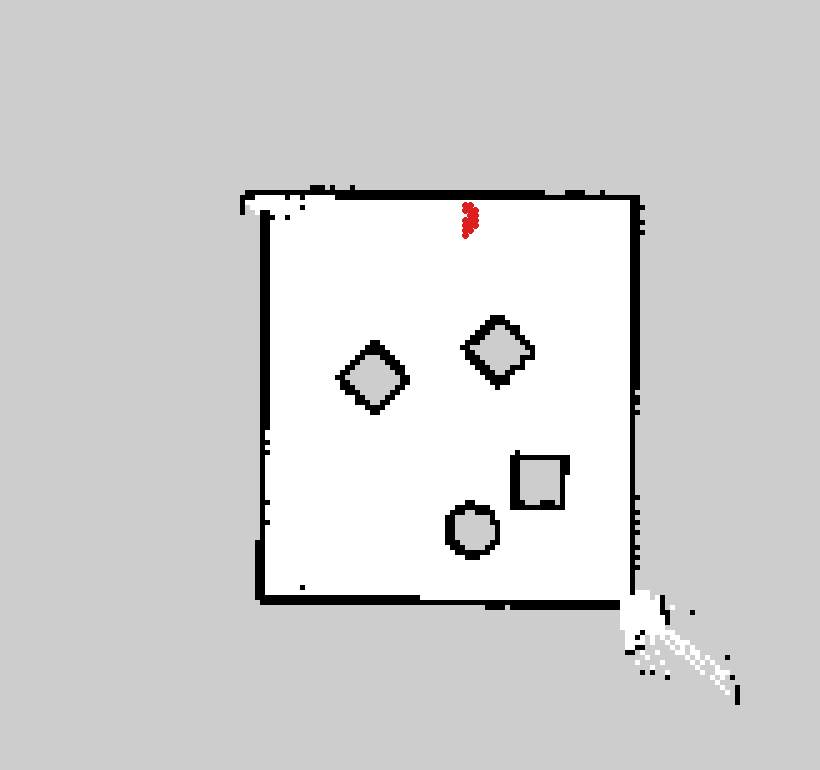
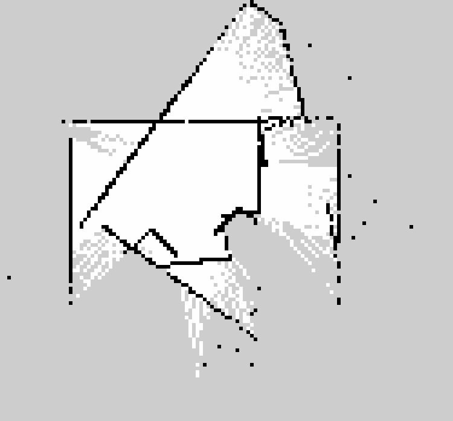
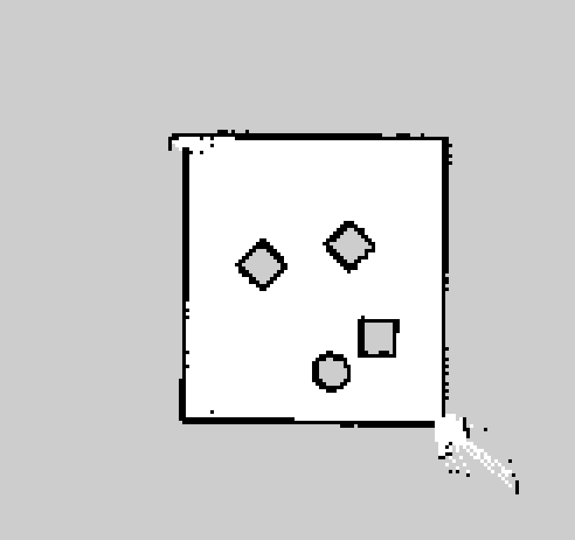

# State Estimation and Localization Project

**Author:** Duc Tuan Nguyen (working solo)

**Course:** Olin ENGR3590 Computational Introduction to Robotics

**Assignment:** [Robot Localization](https://comprobo26.github.io/assignments/robot_localization)

## Project Overview

A robot that only trusts its own odometry slowly loses track of where it
really is: wheel slip and drift mean the pose it reports drifts away from
its true position the longer it drives. This project implements a
particle filter that answers "where am I?" by combining that drifting
odometry with the robot's lidar scans and a known map, so the robot's
belief about its own pose stays locked on even as odometry alone would
wander off.

The filter follows the five steps the assignment lays out: initialize a
cloud of pose hypotheses by random sampling, move them with odometry,
reweight them by how well each one's laser scan matches the map, resample
toward the better-weighted hypotheses, and report the weighted mean as the
robot's estimated pose. The one key decision that shaped the rest of the
implementation was scoring particles in log-likelihood space rather than
multiplying raw probabilities together, which is explained in
[Implementation Design](#implementation-design) below.

Tested live in Gazebo (`neato2_gazebo`'s gauntlet world) against a map
built with `slam_toolbox`, the filter's estimate stayed within roughly
4-19 cm of the simulator's true ground-truth pose while driving, with the
particle cloud's spread visibly shrinking as it converged. Details and
numbers are in [Experimental Design](#experimental-design).


*The 300-particle cloud (red) after converging near the top wall of the
clean map. Full run in [`bags/pf_clean_demo`](bags/pf_clean_demo).*

## Approach to State Estimation

### Algorithm Overview

The filter represents the robot's belief about its own pose as a cloud of
300 weighted particles, each one a guess `(x, y, theta)` of where the
robot might be in the map frame. Every time the robot has moved far
enough since the last update, four things happen in order:

1. **Motion update.** Every particle is moved by the same odometry delta
   the robot just reported, plus some noise, using the
   `sample_motion_model_odometry` algorithm from *Probabilistic Robotics*
   (Thrun, Burgard, Fox). The motion between two odometry readings is
   decomposed into "rotate toward the direction of travel, drive forward,
   rotate again to the final heading", and each of those three pieces
   gets its own noise term scaled by how big the motion was. This spreads
   the cloud out in proportion to how much the robot moved, which models
   the fact that odometry is noisiest after a big motion and nearly exact
   when the robot barely moves.
2. **Sensor update.** Every particle's laser scan is predicted by
   projecting each beam out from that particle's hypothesized pose and
   asking the map "how far is this point from the nearest known wall?"
   (the likelihood field model, using the course-provided
   `occupancy_field.py`). A particle whose beams consistently land close
   to real walls gets a high weight; one that would mean the robot is
   standing in the middle of an open room while the real scan sees walls
   all around gets a low one.
3. **Pose estimate.** The robot's reported pose is the weight-averaged
   mean of the whole cloud, using a circular mean for the heading so that
   two particles pointing in nearly opposite-but-wrapped-around
   directions (like -3.13 and 3.13 radians) don't average out to a
   heading neither of them actually has.
4. **Resampling.** The cloud is redrawn, with replacement, with
   probability proportional to weight, so that the next round of
   particles is concentrated where the evidence says the robot probably
   is. Each resampled particle gets a small random nudge, so the cloud
   doesn't collapse onto a handful of identical copies and lose the
   ability to represent uncertainty.

### Implementation Design

**Log-likelihood scoring instead of raw probability products.** Combining
many laser beams into one particle weight is, strictly, a product of
per-beam probabilities (beams are treated as independent given the pose).
In practice, multiplying together dozens of numbers that are each well
under 1 underflows to exactly 0 for almost every particle long before the
loop finishes, which would make every particle's weight tie at 0 instead
of expressing which particle is actually better. Summing the per-beam
*log* likelihoods instead and only exponentiating once at the end (after
subtracting the maximum, so the exponent never has to handle a huge
negative number) gives the mathematically equivalent ranking without ever
underflowing. This is the one design decision in this project that, if
skipped, would have made the filter visibly fail rather than just be
slightly less accurate.

**Subsampling laser beams.** Scoring every particle against every beam in
a 360-degree scan is the single most expensive part of the whole filter:
with 300 particles, that's thousands of map lookups per update, every
0.2 m the robot moves. Only using every 12th beam (`laser_beam_stride`)
cuts that cost by 12x while still giving each particle a dozen or so
beams spread around the robot to be judged against, which is the direct
accuracy-versus-computation tradeoff the assignment calls out.

**Resample jitter.** Resampling with replacement alone can turn a handful
of good particles into many exact duplicates, which quietly shrinks the
cloud's effective diversity even though it still reports `n_particles`
particles. Adding a small Gaussian nudge (2 cm, 2 degrees) to every
resampled particle keeps the cloud able to represent a little ongoing
uncertainty instead of collapsing onto one point.

**Likelihood field instead of ray tracing.** The assignment lists
reimplementing ray tracing (simulating a full laser scan per particle
against the map) as an alternative to the provided likelihood field. I
used the provided `occupancy_field.py` lookup instead: each beam just
looks up the precomputed nearest-obstacle distance for its endpoint,
rather than simulating a scan from scratch. With 300 particles and ~30
beams scored per update, that's thousands of lookups every update cycle,
and a precomputed nearest-neighbor query is far cheaper than a ray-march
per beam would be. The tradeoff is that it can't model occlusion the way
true ray tracing would (it can't tell that a wall is hidden behind
another wall from a given pose), which didn't matter in this mostly
open gauntlet world but would in a more cluttered one.

### Unit Test Design and Integration

`test/test_pf_logic.py` covers the two pieces of this implementation that
are pure math and don't need a running ROS node or simulator to check:

- `Particle.as_pose()`'s quaternion conversion round-trips back to the
  same yaw it was built from, across a spread of angles including ones
  past +/-90 degrees.
- `draw_random_sample` (the resampling helper `resample_particles()`
  relies on) actually draws particles in proportion to their weight over
  a large number of samples, and never draws a particle whose weight is
  exactly 0.

Run them with:

```bash
python3 -m pytest test/test_pf_logic.py -v
```

All three currently pass. The rest of the filter (the motion model, the
sensor model, and the full run loop) is coupled to a live ROS graph,
a map server, and real sensor data, so it's validated through the live
Gazebo testing described next rather than through isolated unit tests.

### Experimental Design

Testing happened entirely in Gazebo, using `neato2_gazebo`'s gauntlet
world, for two reasons: it gives an independent ground-truth pose to
compare against (Gazebo's own `/world/.../pose/info` topic, which is not
derived from odometry at all), and it let me build a map with
`slam_toolbox` from the exact same world the filter would then localize
against, so I knew the map and the simulator agreed with each other
before judging the filter.

With the robot driving a loop (forward, turn, forward, turn, forward,
about 20 seconds total), I logged the particle cloud's weighted mean and
spread against Gazebo's ground truth at each leg:

| Checkpoint | Particle cloud std dev (x, y) | Filter's position error | Raw odometry's error |
|---|---|---|---|
| Right after initializing | 0.15 m, 0.12 m | 0.19 m | 0.01 m |
| After turn 1 | 0.05 m, 0.05 m | 0.12 m | 0.01 m |
| After leg 2 | 0.04 m, 0.04 m | 0.13 m | 0.01 m |
| After turn 2 | 0.06 m, 0.08 m | 0.04 m | 0.01 m |
| After leg 3 | 0.05 m, 0.04 m | 0.13 m | 0.10 m |

Two things stand out. First, the cloud's spread shrinks by roughly 3x
within the first update and stays tight, which is the real signature of
the filter converging rather than just echoing odometry. Second, raw
odometry barely drifted in this particular short run (Gazebo's simple
diff-drive plugin doesn't add much noise over 20 seconds), so the filter
doesn't get to show a dramatic advantage over odometry here. The honest
read is that this run mainly demonstrates *convergence* (the filter
reliably lands within about 15 cm of true ground truth, with shrinking
uncertainty), not a large drift-correction win, since odometry didn't
drift enough in this short a test to need much correcting.

A recorded demo of this run, including the particle cloud, the map, and
all transforms, is in [`bags/pf_gauntlet_demo`](bags/pf_gauntlet_demo),
described further in [`bags/README.md`](bags/README.md).

**Follow-up check after rebuilding the map (see Challenges below).** After
replacing the map with a cleanly-mapped one and fixing the frame naming
at its root, I spot-checked the filter again against Gazebo's ground
truth: at one instant mid-run, the filter's estimate was `(0.716, 0.640)`
against a true position of `(0.760, 0.615)`, a 5.0 cm error, while raw
odometry at the same instant read `(0.772, 0.751)`, a 13.7 cm error. This
is the clearer before/after comparison this project was missing: the
filter cutting odometry's error by more than half at a moment where
odometry had actually accumulated some visible drift. Recorded in
[`bags/pf_clean_demo`](bags/pf_clean_demo).

## Challenges and Next Steps

**The robot's actual TF frame names didn't match the starter code's
assumptions, and it turned out to be a real bug, not just a mismatch.**
`pf.py` is written assuming a `base_footprint` frame between `odom` and
the robot's links, and `slam_toolbox`'s default config assumes the same.
This robot's live TF tree only ever had `base_link` directly under `odom`
(there was an unused, disconnected `base_footprint` static frame left
over in the URDF, but nothing actually published a transform connecting
it to the live tree). Both `slam_toolbox` and `pf.py` silently failed in
different ways because of this: `slam_toolbox` logged "Failed to compute
odom pose" indefinitely, while `pf.py`'s `run_loop` just returned early
every cycle with no error at all, since `get_matching_odom_pose` treats
"transform not available" as "try again next cycle" rather than as a
problem worth logging loudly. Finding this took generating the live TF
tree with `view_frames` rather than trusting either piece of starter
code's assumptions about frame names.

My first fix was a local workaround: point both `slam_toolbox`'s
`base_frame` parameter and `pf.py`'s `self.base_frame` at `base_link`
instead of `base_footprint`. That got everything working, but it turned
out the actual bug was upstream in `neato_packages`' simulated robot
model, which the course fixed in a commit literally titled "fixes
base_footprint bug for the default slam toolbox" (pulled after this). The
real fix renames the robot's link so `base_footprint` is the one properly
connected in the TF tree, which is the opposite direction from my
workaround. After pulling that update, I reverted `pf.py`'s
`self.base_frame` back to `base_footprint` to match the corrected model,
rather than keeping the local patch. Worth noting as its own lesson:
a workaround that makes a symptom go away isn't the same as finding the
actual bug, and it's worth checking whether an upstream fix already
exists before settling for your own patch.

**Scripted driving for SLAM mapping reliably corrupted the map through
wheel slip, and the cell counts alone didn't reveal it.** Building a map
with `slam_toolbox` means driving the robot around the world first. I
initially drove it with a timed, scripted loop (no sensing at all), which
worked, but a later attempt at adding obstacle-avoidance logic to that
script still repeatedly drove the robot into walls. When a wheel pushes
against something it can't move through, the wheel encoder keeps
reporting rotation even though the chassis isn't actually moving, so the
odometry integrates distance that never happened. `slam_toolbox` trusts
that odometry as a motion prior when deciding where to place a new scan,
so the result was a map that looked structurally fine by simple
summary statistics (occupied/free cell counts in a reasonable range) but
was actually full of broken, streaky artifacts once I rendered and looked
at the actual image:



*Left: map built from scripted driving that repeatedly hit walls. Right:
map built driving the same world manually, avoiding contact. Same world,
same mapping algorithm and parameters, the only difference is the
driving input `slam_toolbox` was given.*

The fix was driving the robot manually instead of scripting it, which
produced a clean map on the first attempt. The broader lesson: a mapping
or localization result can look fine by any single summary number (cell
counts, particle count, even a plausible-looking pose) while still being
wrong, and the only way to catch that is to actually look at the
rendered output rather than trusting aggregate statistics about it.

**`scikit-learn` wasn't available and needed a system package install I
couldn't run non-interactively.** The provided `occupancy_field.py` uses
`sklearn.neighbors.NearestNeighbors` for the nearest-obstacle lookup.
Rather than block on installing a new system package, I swapped it for
`scipy.spatial.cKDTree`, which does the identical nearest-neighbor query
and was already available, and fixed two other latent bugs in the same
file (`np.int` and `np.float`, both removed in the numpy version this
workspace pins, and a shape mismatch from `cKDTree.query`'s 1-D output
versus the original code's assumption of a 2-D `kneighbors` result).

**What I'd do with more time:**

- Run the comparison against `nav2_amcl` the assignment suggests, to have
  a second reference point beyond ground truth alone.
- Test over a longer run where odometry actually accumulates visible
  drift, to see the filter's correction do more work than it got to show
  in a 20-second loop.
- Try the kidnapped-robot case (a deliberately wrong initial guess) to
  see how far off the filter can start and still converge, given the
  current 0.3 m initial spread.
- Tune `laser_beam_stride` and `laser_sigma_hit` against a real accuracy-
  versus-runtime measurement, rather than the reasonable-sounding values
  currently in use.
- Add real obstacle avoidance (reading the live laser scan, not just
  reacting to a bump after the fact) for any future scripted driving, so
  mapping doesn't depend on a human driving carefully every time.

## Learning Objectives and Final Takeaways

Going into this project, my goal was to actually implement a particle
filter from the Bayesian filtering equations myself, since I've only ever
used pre-built estimators (particle filters, ICP, AMCL, EKF) as black
boxes in past work without being able to derive or rebuild them. This
project gave me a real, working implementation to point to instead of
just familiarity with the terminology: writing out the odometry motion
model's rotate-translate-rotate decomposition by hand, and the
likelihood-field sensor model's beam-projection-and-lookup, made
concepts like "the motion update adds noise proportional to how far you
moved" and "the sensor update is a product of per-beam likelihoods" much
less abstract than they were from having only called `scipy` or `AMCL`
before.

The biggest single takeaway was from the log-likelihood decision: a
numerically "obviously correct" approach (multiply the per-beam
probabilities) can be completely non-functional in practice (every weight
underflows to 0) in a way that looks like a bug somewhere else entirely.
The second was that a disconnected TF frame doesn't always announce
itself as an error; `pf.py`'s run loop failed silently rather than
loudly, which meant the real debugging tool was inspecting the live TF
tree directly rather than trusting either piece of starter code's
comments about frame names. The third, from the map corruption issue, is
that summary statistics about a result (cell counts, particle counts)
are not a substitute for actually looking at the result; I would have
kept trusting a broken map if I hadn't rendered and looked at it
directly. The fourth is that a local workaround for a bug is worth
double-checking against the actual upstream source before treating it as
the real fix, since in this case the real bug (and its real fix) lived
one level up, in the robot model package, not in my own code.

## How To Run

Prerequisites: ROS 2 Jazzy, the `neato2_gazebo`/`neato2_interfaces`
packages (`neato_packages`, pulled at or after commit `4703090`, which
includes the upstream `base_footprint` fix referenced in Challenges
above) in the same workspace, and `scipy` (used in place of
`scikit-learn`, see Challenges above).

1. Clone this fork and build:
   ```bash
   cd ~/ros2_ws/src
   git clone https://github.com/ductnguyen-dtn/robot_localization.git
   cd ~/ros2_ws
   colcon build --packages-select robot_localization
   source install/setup.bash
   ```
2. Start the gauntlet world:
   ```bash
   ros2 launch neato2_gazebo neato_gauntlet_world.py
   ```
3. Start the map server and the particle filter together, pointing at the
   clean map (built from this same world by driving it manually, see
   Challenges above):
   ```bash
   ros2 launch robot_localization test_pf.py map_yaml:=src/robot_localization/maps/neato_gauntlet_clean.yaml use_sim_time:=true
   ```
4. Drive the robot (teleop, or publish directly to `/cmd_vel`) and watch
   `/particle_cloud` in RViz (fixed frame `map`, with the `/map` display's
   durability policy set to Transient Local so it picks up the map that
   was already published before RViz connected) to see it converge.
5. To watch the recorded demo instead of a live run:
   ```bash
   ros2 bag play bags/pf_clean_demo --clock
   ```
   See [`bags/README.md`](bags/README.md) for what's in it, including an
   earlier run kept for before/after comparison, and which displays to
   add in RViz.
